# claude-model-router

**English** · [Português](README.pt-BR.md)

A **Claude Code skill** that sends each task to the cheapest model that can do it well: **Sonnet** by default, **Haiku** for mechanical work, and **Opus** for security, payments and hard problems. Same quality, lower usage.

<p align="center">
  
</p>

## Why
Running everything on the biggest model burns your usage limit on work a smaller model does just as well. This skill sets Sonnet as the default, hands simple jobs to Haiku, and escalates to Opus only when needed. In the author's test it cost 56% less than Opus alone (see [Measured result](#measured-result)).

## Install
Pick **one** of the two ways. Do not use both: the skill and the agents would show up twice (the installer warns you if it finds the plugin).

### Option A: plugin (updates itself)
Inside Claude Code:

```text
/plugin marketplace add leotrvs/claude-model-router
/plugin install model-router@leotrvs
```

Open a new session. The skill loads by itself when a task is big enough, and you can call it with `/model-router:route`.

To receive new versions automatically, open `/plugin`, go to **Marketplaces**, select `leotrvs` and choose **Enable auto-update**. It is off by default for third-party marketplaces. Without it, run `/plugin marketplace update leotrvs` when you want the latest version.

What differs from option B:
- English only.
- A plugin cannot write to your `CLAUDE.md`, so a session-start hook adds the short rule instead.
- A plugin cannot set your default model. Set `"model": "sonnet"` yourself if you want Sonnet as the default.
- The agents are named `model-router:executor-haiku`, `model-router:executor-sonnet` and `model-router:executor-opus`, and there is no delegation log.
- The blocking hooks are the same.

### Option B: installer (needs Node.js 18+)
```bash
git clone https://github.com/leotrvs/claude-model-router.git
cd claude-model-router
node install.js
```

Open a new Claude Code session. The skill loads by itself when a task is big enough, and you can call it with `/claude-model-router`.

> The skill and the installer speak English by default. For the Portuguese version, run `node install.js --lang pt-BR`. Updating keeps the language you already use.

To update, run `git pull` and `node install.js` again.

## How it routes
| Task | Goes to |
|---|---|
| Searches, summaries, renames, formatting | `executor-haiku` |
| Anything users can see (UI), features with a plan, tests, ordinary migrations | `executor-sonnet` |
| **Security and payments**, architecture, bugs with no clear cause, sensitive migrations | `executor-opus` |

- It only delegates when a task touches **more than 5 files or needs more than 10 actions**. Below that, Claude does it directly.
- The agent gets a written brief and its diff is reviewed before the work counts as done. `STATUS: PRONTO` is not proof.
- If an agent fails, the task moves up one level: Haiku, then Sonnet, then Opus.
- **Hooks enforce the sharpest rules**: Haiku cannot write UI files, and Haiku and Sonnet cannot write to security or payment paths or to sensitive SQL migrations.

## What the installer changes (option B)
<details>
<summary>Click to expand</summary>

In `~/.claude` (your user folder):
- creates `skills/claude-model-router/`, `agents/executor-*.md` and the hooks in `hooks/`
- adds or updates only the block between `<!-- claude-model-router:start -->` and `<!-- claude-model-router:end -->` in `CLAUDE.md`
- in `settings.json`, registers a hook that logs each delegation to `~/.claude/delegations.jsonl`, and sets `"model": "sonnet"` **only if you have no model set**. Use `--no-model` to never set it.
- keeps a copy of your originals as `settings.json.before-claude-model-router` and `CLAUDE.md.before-claude-model-router`, never overwriting an existing copy
- validates everything before writing: if your `settings.json` is invalid, nothing is changed

At the end it prints what it created, what it updated and how to undo it. The old commands (`instalar.js`, `--projeto`, `--sem-modelo`, `--definir-modelo`) still work, and updating an older install migrates it automatically.
</details>

## Use it in a repository or in the cloud
<details>
<summary>Click to expand</summary>

Cloud sessions do not have the `~/.claude` of your computer, so the skill has to live inside the repository:

```bash
node install.js --project "/path/to/your/repo"
```

Then commit and push `.claude/` and `CLAUDE.md`. This mode writes only inside that folder, never commits, does not install the delegation log, and refuses your home folder and the disk root. The `"model"` in `.claude/settings.json` applies to your whole team, so it is only set with `--set-model`.

To install without your computer, paste this into a cloud session of your project:

```text
Install the claude-model-router skill in this repository. Never change main, never merge and never open a PR.
1. Work on a branch other than main. If the session already has its own branch, use that one.
2. Run: git clone --depth 1 --branch v1.2.0 https://github.com/leotrvs/claude-model-router.git /tmp/claude-model-router
3. At the root of this repository, run: node /tmp/claude-model-router/install.js --project .
4. git add only .claude/skills .claude/agents .claude/hooks .claude/settings.json CLAUDE.md, commit, and push the branch.
5. If any of those paths is in .gitignore, stop and tell me.
6. At the end, tell me the branch name and the list of files in the commit.
```

It pins version `v1.2.0` and runs this repository's installer, so read the code first. Open a new session on that branch afterwards: skills load at the start of a session, and until you merge, it only works on that branch.

**Not yet tested in a real cloud session.** The first time, ask an `executor-sonnet` to write `drop table test;` into a test migration and confirm it is blocked.
</details>

## Limits
- **The hooks are a convenience guard against model mistakes, not a security barrier.** They only read `Edit`, `Write`, `MultiEdit` and `NotebookEdit`, they use heuristics, and the executors have `Bash`, which can write files without going through them.
- The block applies only to the executors. The main session follows the written rule.
- The SQL analysis is a heuristic. It can block too much (for example names like `tokenizer.ts`) or miss constructs it does not know.
- The migration and sensitive-path rules are built for web projects on Postgres/Supabase. Adjust the lists in `hooks/block-sensitive.js` to your project.
- It needs a plan with Opus access; without it, `executor-opus` cannot run.
- The plugin has not been tried in a cloud session yet. For cloud sessions use the repository install below.

## Measured result
In the author's measurements (4 simple tasks, 3 rounds, 24 runs, cost estimated in dollars by Claude Code), Sonnet with delegation cost 56% less than Opus alone, with 12 of 12 passing the automatic checks in both modes. Almost all the savings came from using Sonnet as the default; delegating to Haiku accounted for less than 3%. The data from that test is not in this repository, and results vary with your project and installed plugins.

## Tests
```bash
node tests/run.js
```
Runs the hook, installer and plugin cases with no dependencies and no network. The installer is tested in temporary folders and never touches your `~/.claude`.

The `plugin/` folder is **generated**: edit `locales/en/` and `hooks/`, then run `node scripts/build-plugin.js`. The tests fail if `plugin/` is out of date. `node tests/plugin-live.js` runs the plugin in a real Claude Code session in a throwaway repository (it needs the `claude` CLI and makes a few model calls).

## License
[MIT](LICENSE)
