# claude-model-router

[English](README.md) · **Português**

Uma **skill do Claude Code** que manda cada tarefa para o modelo mais barato capaz de fazê-la bem: **Sonnet** como padrão, **Haiku** para o trabalho mecânico e **Opus** para segurança, pagamento e problemas difíceis. Mesma qualidade, menos consumo do seu limite.

<p align="center">
  
</p>

## Por que usar
Rodar tudo no maior modelo gasta o seu limite em trabalho que um modelo menor faz igualmente bem. A skill define o Sonnet como padrão, entrega o trabalho simples ao Haiku e só sobe para o Opus quando precisa. No teste do autor, custou 56% menos que usar só o Opus (veja [Resultado medido](#resultado-medido)).

## Instalar
Escolha **uma** das duas formas. Não use as duas: a skill e os agentes apareceriam duas vezes (o instalador avisa se encontrar o plugin).

### Opção A: plugin (atualiza sozinho)
Dentro do Claude Code:

```text
/plugin marketplace add leotrvs/claude-model-router
/plugin install model-router@leotrvs
```

Abra uma sessão nova. A skill entra sozinha quando a tarefa é grande o bastante, e você também pode chamá-la com `/model-router:route`.

Para receber as versões novas automaticamente, abra `/plugin`, vá em **Marketplaces**, selecione `leotrvs` e escolha **Enable auto-update**. Ele vem desligado por padrão em marketplaces de terceiros. Sem isso, rode `/plugin marketplace update leotrvs` quando quiser a versão mais recente.

O que muda em relação à opção B:
- Só em inglês por enquanto. Para usar em português, escolha a opção B.
- Um plugin não consegue gravar no seu `CLAUDE.md`, então um hook de início de sessão adiciona a regra curta no lugar.
- Um plugin não consegue definir o seu modelo padrão. Defina `"model": "sonnet"` você mesmo se quiser o Sonnet como padrão.
- Os agentes se chamam `model-router:executor-haiku`, `model-router:executor-sonnet` e `model-router:executor-opus`, e não há registro de delegações.
- Os hooks de bloqueio são os mesmos.

### Opção B: instalador (precisa do Node.js 18+)
```bash
git clone https://github.com/leotrvs/claude-model-router.git
cd claude-model-router
node install.js --lang pt-BR
```

Abra uma sessão nova do Claude Code. A skill entra sozinha quando a tarefa é grande o bastante, e você também pode chamá-la com `/claude-model-router`.

Para atualizar, rode `git pull` e `node install.js --lang pt-BR` de novo. O instalador usa inglês por padrão, mas mantém o idioma que você já usa.

## Como ela escolhe
| Tarefa | Vai para |
|---|---|
| Buscas, resumos, renomeações, formatação | `executor-haiku` |
| Tudo que o usuário vê (interface), features com plano, testes, migrations comuns | `executor-sonnet` |
| **Segurança e pagamento**, arquitetura, bug sem causa clara, migrations sensíveis | `executor-opus` |

- Ela só delega quando a tarefa envolve **mais de 5 arquivos ou mais de 10 ações**. Abaixo disso, o Claude faz direto.
- O agente recebe um briefing escrito e o diff dele é revisado antes de a tarefa valer como pronta. `STATUS: PRONTO` não é prova.
- Se um agente falha, a tarefa sobe um nível: Haiku, depois Sonnet, depois Opus.
- **Hooks aplicam as regras mais rígidas**: o Haiku não grava arquivos de interface, e o Haiku e o Sonnet não gravam em caminhos de segurança ou pagamento nem em migrations SQL sensíveis.

## O que o instalador altera (opção B)
<details>
<summary>Clique para abrir</summary>

Em `~/.claude` (a pasta do seu usuário):
- cria `skills/claude-model-router/`, `agents/executor-*.md` e os hooks em `hooks/`
- acrescenta ou atualiza, no `CLAUDE.md`, só o bloco entre `<!-- claude-model-router:start -->` e `<!-- claude-model-router:end -->`
- no `settings.json`, registra um hook que anota cada delegação em `~/.claude/delegations.jsonl` e define `"model": "sonnet"` **somente se você ainda não tiver um modelo definido**. Use `--no-model` para nunca definir.
- guarda cópia dos originais em `settings.json.before-claude-model-router` e `CLAUDE.md.before-claude-model-router`, sem sobrescrever uma cópia que já exista
- valida tudo antes de gravar: se o seu `settings.json` for inválido, nada é alterado

Ao terminar, ele lista o que criou, o que atualizou e como desfazer. Os comandos antigos (`instalar.js`, `--projeto`, `--sem-modelo`, `--definir-modelo`) continuam funcionando, e atualizar uma instalação antiga a migra sozinho.
</details>

## Usar em um repositório ou na nuvem
<details>
<summary>Clique para abrir</summary>

Sessões na nuvem não têm o `~/.claude` do seu computador, então a skill precisa estar dentro do repositório:

```bash
node install.js --project "C:/caminho/do/repositorio" --lang pt-BR
```

Depois faça commit e push de `.claude/` e `CLAUDE.md`. Esse modo só grava na pasta indicada, nunca faz commit, não instala o registro de delegações e recusa a sua pasta pessoal e a raiz do disco. O `"model"` do `.claude/settings.json` vale para o time inteiro, então só é definido com `--set-model`.

Para instalar sem usar o seu computador, cole em uma sessão na nuvem do projeto:

```text
Instale a skill claude-model-router neste repositório. Nunca altere a main, não faça merge e não abra PR.
1. Trabalhe em uma branch que não seja a main. Se a sessão já tiver uma branch própria, use essa.
2. Rode: git clone --depth 1 --branch v1.2.0 https://github.com/leotrvs/claude-model-router.git /tmp/claude-model-router
3. Na raiz deste repositório, rode: node /tmp/claude-model-router/install.js --project . --lang pt-BR
4. Faça git add somente de .claude/skills .claude/agents .claude/hooks .claude/settings.json CLAUDE.md, faça o commit e dê push da branch.
5. Se algum desses caminhos estiver no .gitignore, pare e me avise.
6. No final, informe o nome da branch e a lista de arquivos do commit.
```

O prompt usa a versão fixa `v1.2.0` e executa o instalador deste repositório, então leia o código antes. Depois abra uma sessão nova nessa branch: a skill só carrega no início da sessão e, até o merge, só funciona nela.

**Ainda não foi testado em uma sessão real na nuvem.** Na primeira vez, peça a um `executor-sonnet` para gravar `drop table teste;` em uma migration de teste e confirme que foi bloqueado.
</details>

## Limites
- **Os hooks são uma barreira de conveniência contra erro do modelo, não de segurança.** Eles leem só `Edit`, `Write`, `MultiEdit` e `NotebookEdit`, usam heurística, e os executores têm `Bash`, que grava arquivos sem passar por eles.
- O bloqueio só vale para os executores. A sessão principal segue a regra escrita.
- A análise de SQL é heurística. Pode bloquear de mais (por exemplo, nomes como `tokenizer.ts`) ou deixar passar construções que ela não conhece.
- As regras de migration e de caminhos sensíveis são pensadas para projetos web com Postgres/Supabase. Ajuste as listas em `hooks/block-sensitive.js` ao seu projeto.
- Exige um plano com acesso ao Opus; sem ele, o `executor-opus` não roda.
- O plugin ainda não foi testado em sessão na nuvem. Para a nuvem, use a instalação por repositório abaixo.

## Resultado medido
Nas medições do autor (4 tarefas simples, 3 rodadas, 24 execuções, custo estimado em dólar pelo Claude Code), Sonnet com delegação custou 56% menos que Opus puro, com 12 de 12 nas checagens automáticas dos dois modos. A economia veio quase toda de usar o Sonnet como padrão; a parte delegada ao Haiku pesou menos de 3%. Os dados desse teste não estão neste repositório e o resultado varia com o projeto e com os plugins instalados.

## Testes
```bash
node tests/run.js
```
Roda os casos dos hooks, do instalador e do plugin sem dependências e sem rede. O instalador é testado em pastas temporárias e não toca no seu `~/.claude`.

A pasta `plugin/` é **gerada**: edite `locales/en/` e `hooks/` e rode `node scripts/build-plugin.js`. Os testes falham se `plugin/` estiver desatualizada. `node tests/plugin-live.js` roda o plugin em uma sessão real do Claude Code, em um repositório descartável (precisa do `claude` no PATH e faz algumas chamadas ao modelo).

## Licença
[MIT](LICENSE)
